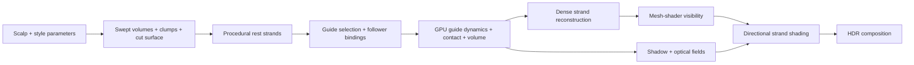

# From Style to Strands

### Procedural Hairstyle Generation, GPU Hair Dynamics & Strand Rendering in Vulkan

**A real-time, interactive hair system built in C++17, Vulkan, and GLSL.**

This project brings hairstyle design, physical motion, and strand-level rendering into one workflow. A procedural style representation defines the silhouette, flow, locks, length, and fine texture. A reduced set of GPU-simulated guide strands drives dense hair geometry, which is reconstructed and shaded at render time.

The underlying idea is to give each scale of the problem the representation it needs, while preserving a consistent correspondence from authored hairstyle to moving, visible fibers.

**[Read the technical report](docs/TECHNICAL_REPORT.md)** · **[Grooming guide](docs/GROOMING_GUIDE.md)** · **[Rendering notes](docs/RENDERING_NOTES.md)**

## At a glance

| | Current configuration |
|---|---|
| Procedural render strands | **110,000** |
| GPU simulation guides | **1,600** |
| Guide control points | 20 per guide |
| Hairstyle presets | **28** structured, editable designs |
| Physics | Constraint-based guide dynamics, wind, body contact, grid-based volume interaction |
| Rendering | Vulkan task/mesh shaders, MSAA strand visibility, directional fiber reflection |
| Implementation | C++17 · Vulkan 1.3 · GLSL |

Configuration values shown above; performance measurements are documented separately.

## What the system does

### 1. Procedural hairstyle generation

Hair begins with stable scalp coordinates and barycentric root bindings on the character mesh. A compact style graph constructs the overall hairstyle from **root regions and swept cross-section curves**. Two levels of clumps organize large locks and finer groups, while a **4 × 4 Bézier cut surface** controls length and layering. Waves, curls, frizz, and flyaways are added as increasingly fine, coherent detail.

The same generator supports long layered styles, bobs, ponytails, buns, wavy and curly cuts. Artists can edit flow, hairline, length, density-related fields, root lift, clumps, and color in the interactive studio.

### 2. Reduced GPU simulation

The authored strands provide a rest-shape basis for **1,600 dynamic guides**. Dense strands bind to four compatible guides using root-space proximity and tangent information, with hairstyle and clump topology constraining the search. GPU simulation handles stretching, bending, wind, and character contact. A **48³ interaction grid** captures collective hair movement and packing at a coarser scale.

Guide deformation is transferred to dense fibers through transported local frames. The geometric detail from the authored hairstyle stays attached to its moving structure.

### 3. Strand-level rendering

Vulkan task and mesh shaders expand guide-driven strands into physical-width visibility geometry, with adaptive longitudinal tessellation. **Per-sample MSAA coverage** separates which fibers are visible from how they reflect light. Shading uses a pigmented body-reflection approximation, anisotropic dielectric GGX highlights, directional studio illumination, guide-derived Deep Opacity Maps, and a secondary fiber-internal TT/TRT model. The final image is composed in HDR and tone-mapped for display.

### 4. Interactive workflow and GPU systems

The editor includes a searchable hairstyle library, grooming controls, material and lighting adjustments, and rendering diagnostics. Derived groom caches and persistent Vulkan pipeline caches reduce repeated preparation. GPU work is divided according to the update frequency of the style, guide dynamics, optical fields, and rendered frame.

## Pipeline



For the mathematical models, data layouts, and implementation choices, see the **[full technical report](docs/TECHNICAL_REPORT.md)**. It covers the procedural construction, guide representation, simulation, light transport, caching, and suggested evaluation experiments, with pointers to the corresponding source files.

## Build and run

### Requirements

- A **Vulkan 1.3** GPU supporting `VK_EXT_mesh_shader` (task + mesh shaders), sample-rate shading, and the features checked during device selection.
- **Vulkan SDK** with `glslc` available; on Windows, `VULKAN_SDK` must be set.
- **CMake 3.24+**, Git, and a C++17 toolchain (Visual Studio C++ build tools on Windows).
- Internet access for the first CMake configure, to fetch pinned GLFW, GLM, Dear ImGui, nlohmann/json, and the upstream ICT FaceKit neutral-head asset. Local FaceKit paths are supported for offline builds.

**Windows** — from the repository directory:

```powershell
.\build_and_run_windows.bat
```

The launcher builds into `build/`, starts the application, and writes persistent diagnostics to `logs/last_run.log` if something fails. For a fresh CMake build cache:

```powershell
$env:V47_CLEAN = '1'
.\build_and_run_windows.bat
```

**Linux** — with a configured Vulkan SDK and compatible toolchain:

```bash
./build_and_run_linux.sh
```

You can also use CMake directly:

```bash
cmake -S . -B build -DCMAKE_BUILD_TYPE=Release
cmake --build build --config Release --parallel
```

**Note:** The ICT FaceKit neutral OBJ is fetched at configure time and copied beside the executable. The asset and its license are distributed by the upstream project; see [third-party notices](docs/THIRD_PARTY_NOTICES.md).

## Explore the studio

Use the **HAIRSTYLES** library to select a preset, then shape the groom from broad volume and flow to clumps, cut length, and fine texture. The physical simulation uses the generated rest groom, and **HAIR OPTICS** controls material appearance, direct lights, environment, and diagnostic passes.

The renderer exposes separate views for material appearance, reflected body color, dielectric highlights, direct-light visibility, and internal transport. These are useful for checking how editing, lighting, and shadowing contribute to the final look.

## Repository layout

```text
assets/grooms/        28 procedural hairstyle presets (JSON)
assets/character/      Character-asset instructions (OBJ downloaded on build)
src/                   C++ editor, groom construction, bindings, contact, Vulkan app
shaders/               GLSL simulation, geometry generation, shadows, and shading
tools/                 Windows launcher and numerical / asset checks
docs/                  Technical report, grooming guide, rendering notes, notices
verify_project.py      Source-level architecture checks
CMakeLists.txt         Dependencies, shaders, executable, and asset staging
```

## Checks and reproducibility

```bash
python verify_project.py
python tools/validate_groom_assets.py
python tools/test_v47_transport.py
```

The checks cover source invariants, groom assets, and numerical light-transport calculations. The [technical report](docs/TECHNICAL_REPORT.md) also describes GPU timing, visual comparisons, and simulation diagnostics to collect on the target hardware.

## Research background and attribution

The design draws on established ideas from position-based dynamics, strand and rod simulation, deep opacity maps, and physically based hair scattering. References are collected in the [technical report](docs/TECHNICAL_REPORT.md). External libraries and the ICT FaceKit head asset retain their respective upstream licenses; see [third-party notices](docs/THIRD_PARTY_NOTICES.md).

**Author:** Rundong Chen · **Project:** Vulkan Hair Studio

**Source licensing:** No project-wide license has been selected yet. Third-party dependencies and assets retain their respective licenses.
