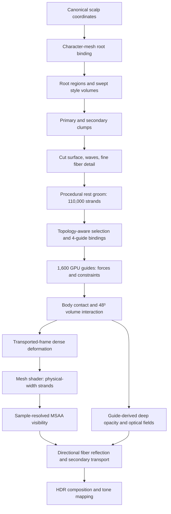

# From Style to Strands
## Procedural Hairstyle Generation, GPU Dynamics, and Strand Rendering in Vulkan

**Rundong Chen**  
**Technical project report · October 2026**  
**Implementation:** C++17 · Vulkan · GLSL · Compute and Mesh Shaders  

---

## Abstract

A hairstyle is a designed three-dimensional structure that must also move and interact with light. Its recognizable shape comes from the arrangement of larger hair masses and locks; its motion emerges from the flexibility and contact of thousands of fibers; its appearance depends on the reflection and visibility of strands that can be thinner than a pixel. These aspects call for different levels of geometric and computational detail.

I developed a fully procedural, interactive hair system in C++ and Vulkan that connects hairstyle construction, physical animation, and strand-level rendering through a shared hierarchical representation. Structured controls describe the scalp regions, spatial flow, volume, clump organization, haircut, and fine texture. From these controls, the system constructs **110,000 render strands** and selects **1,600 simulation guides**. The guides evolve under constraint-based GPU dynamics, character contact, wind, and a coarse volume-interaction field. Dense strands follow the guides through topology-constrained bindings and transported local frames. A Vulkan mesh-shader pipeline then generates the visible strand geometry, resolves subpixel coverage, and shades it using directional pigmented reflection, anisotropic dielectric highlights, and a secondary internal-scattering model.

The central design idea is to represent each property at the scale where it is meaningful: hairstyle shape in a compact authoring graph, deformation in a reduced guide system, collective hair fullness in a grid, and visible detail in dense strands. The report develops that idea from its geometric and physical basis, follows it through the implementation, and outlines experiments for evaluating visual quality, simulation behavior, and GPU performance.

---

## 1. Designing a hair system across scales

### 1.1 What defines a hairstyle?

Consider a long layered hairstyle. At a distance, we recognize the parting, overall silhouette, length profile, and movement of large sections. At an intermediate distance, we see individual locks separate, overlap, and curve. Up close, smaller fibers, flyaways, and specular highlights become visible.

This suggests a hierarchy of features:

- **Large-scale form:** silhouette, directional flow, crown volume, bangs, and the overall arrangement of hair masses.
- **Lock structure:** how fibers gather into coherent groups, where a lock opens, and how neighboring locks overlap.
- **Fine structure:** waviness, curl detail, frizz, flyaways, and fiber thickness.

The same hierarchy carries into animation. The displacement of a lock is largely collective; its individual fibers retain smaller relative offsets. Rendering reverses the scale requirement: we need the dense fibers and their local orientation to produce fine coverage and highlights even though the underlying dynamics can be substantially reduced.

I therefore designed the application around a distinction between **authored shape**, **dynamic degrees of freedom**, and **rendered detail**. They are different representations of the same groom, linked by stable root coordinates and hairstyle topology.

### 1.2 Main system organization

Each operation owns one clear responsibility. A cut surface changes strand lengths. A clump field changes the organization of neighboring strands. Guide motion changes their shared deformation. The material model changes how incident light is reflected from the resulting geometry. Keeping those controls separate makes the system easier to edit, test, and extend.

### 1.3 Implementation scale

The implementation uses the following configuration:

| Representation or setting | Implementation value |
|---|---:|
| Procedural render strands | 110,000 |
| Selected simulation guides | 1,600 |
| Guide control samples | 20 per guide |
| Dense rest-strand samples | 20 per strand |
| Visible rendering samples | 9, 17, or 33 per strand |
| Fiber diameter before local variation | 70 μm |
| Guide volume-interaction grid | 48 × 48 × 48 |
| Optical extinction grid | 64 × 64 × 64 |
| Physics timestep | 1/120 s |
| Included style presets | 28 |

These are code configuration and resource counts. The performance section specifies the measurements needed to characterize actual runtime behavior.

---

## 2. Procedural hairstyle generation

The entire groom is built from structured style parameters and the character's scalp. The application supplies hairstyle graphs, clump controls, local fields, and an optional seed; the builder generates the roots, centerlines, and per-strand details. The 28 included styles are **parameterized designs** that expand procedurally into dense hair geometry. The same mechanism supports subsequent interactive editing.

### 2.1 A stable coordinate system for follicles

Procedural generation begins before any strands exist. Each follicle needs a stable identity and a location that can be recovered when the head mesh or hairstyle changes.

`scalp_domain.hpp` defines a canonical scalp domain using spherical angles. For a sample index and seed, two low-discrepancy-style fractional sequences produce coordinates:

$$
(u_i,v_i) = \left(\operatorname{fract}(c_1+a_1(i+s)),\;\operatorname{fract}(c_2+a_2(i+3s))\right).
$$

Azimuth and polar angle map these parameters to a canonical scalp direction. The upper polar-angle boundary varies around the head, describing the hair-bearing region along the front, back, and sides.

The resulting direction is bound to the target character mesh. `GroomRetargeter` finds the corresponding scalp triangle and stores its triangle index and barycentric coordinates. Given triangle vertices $\mathbf a,\mathbf b,\mathbf c$, the follicle position is

$$
\mathbf p_{\mathrm{root}} = b_0\mathbf a+b_1\mathbf b+b_2\mathbf c,
\qquad b_0+b_1+b_2=1.
$$

The interpolated surface normal supplies the initial strand orientation and root clearance. Stable canonical coordinates serve a second purpose: they let hairstyle controls remain tied to a consistent region of the scalp as the concrete mesh binding changes.

Root bindings are cached against the character mesh fingerprint, sampling seed, and root count. Their spatial ordering uses a Morton code in canonical scalp coordinates, keeping nearby roots together for later strand clustering and memory access.

**Implementation:** `src/scalp_domain.hpp`, `src/groom_binding.cpp`, `src/character_surface.cpp`.

### 2.2 From a style curve to a three-dimensional hair mass

The most important geometric decision is to describe a hairstyle at the scale of its visible mass before constructing individual fibers.

A `StyleCurve` references a sequence of `SweepKey` records. Each key contains a center and two local cross-section vectors:

$$
K_j=(\mathbf c_j,\mathbf a_j,\mathbf b_j).
$$

A cross-sectional coordinate $\boldsymbol\eta=(\eta_1,\eta_2)$ then locates a point inside the style volume:

$$
\boxed{\mathbf S_j(\boldsymbol\eta)=\mathbf c_j+\eta_1\mathbf a_j+\eta_2\mathbf b_j.}
$$

The center controls where the hair mass travels; the two axes control its width, depth, and orientation. Changing an axis can widen a lock or rotate its section without editing thousands of strand paths. Sampling these sections along the keys yields a family of related trajectories.

The builder prepends two specially constructed control points: the follicle itself and a short tangent-aligned attachment segment. The initial tangent follows the authored flow and, near a parting, can be steered by the part-curve field. The subsequent control points come from the swept style volume.

These points are interpolated with **centripetal Catmull–Rom splines**. For neighboring control points, the knot spacing follows

$$
\Delta t_j\propto\sqrt{\|\mathbf p_{j+1}-\mathbf p_j\|}.
$$

This choice handles uneven distances between scalp attachment points and outer style keys while limiting extreme overshoot. The builder samples the resulting curve into the fixed 20-point rest representation.

A style branch connects a `RootPatch`, one style curve, and a topology identifier. `RootPatch` determines which hair mass owns a follicle. The topology identifier is carried forward into guide selection, follower binding, and contact corrections. Thus the geometry's structural meaning survives the transition into simulation.

**Implementation:** `src/groom_asset.hpp` (`RootPatch`, `SweepKey`, `StyleCurve`, `GroomBranch`), `src/groom_builder.cpp` (`assignBranch`, `keyPointWorld`, `sampleSmoothPath`).

### 2.3 Organizing a hair mass into locks

A smooth sweep volume defines the broad shape, while locks provide the mid-scale structure that makes a hairstyle readable.

Each branch uses two `ClumpLevel` fields:

1. **Primary clumps** establish larger locks and their persistent identities.
2. **Secondary clumps** introduce smaller groups and variations inside each primary lock.

For a fiber's material coordinate $\boldsymbol\eta$, the generator finds nearby jittered lattice sites with a Voronoi-like nearest-site search. It blends toward neighboring sites near cell boundaries, producing soft transitions. Secondary site generation includes the primary site's deterministic key, so smaller clusters remain associated with the larger lock.

The effect can be understood as successive attractions:

$$
\boldsymbol\eta_1(u)=
(1-\tau_1(u))\boldsymbol\eta+\tau_1(u)\mathbf q_1(u),
$$
$$
\boxed{\boldsymbol\eta_2(u)=
(1-\tau_2(u))\boldsymbol\eta_1(u)+\tau_2(u)\mathbf q_2(u).}
$$

Here $\mathbf q_1,\mathbf q_2$ are the primary and secondary clump targets. Their attraction strengths $\tau_1,\tau_2$ vary along the strand. Each level exposes root, middle, and tip tightness, which determines whether a lock stays narrow, expands through its middle, or separates near its ends.

The code also supports controlled drift, collective clump waves, twist, and tip spread. Their spatial envelopes preserve the root attachment while changing the mid-length and tip behavior. Large wavy forms are applied coherently at the clump level so neighboring strands share recognizable motion and silhouette.

This level of organization is central to the procedural design. A change in primary clump spacing changes the visible lock composition; a change in secondary spacing changes texture inside those locks. The two controls produce distinguishable, predictable edits.

**Implementation:** `src/groom_builder.cpp` (`nearestClumpSites`, `clumpCoordinate`, `clumpTightnessAt`, `clumpWave`).

### 2.4 Cutting and layering as a continuous surface

Haircut length is determined by a `CutSurface` with a **4 × 4 control lattice**. The controls describe a cubic Bézier surface over the branch's material coordinates:

$$
\boxed{c(u,v)=\sum_{i=0}^{3}\sum_{j=0}^{3}
B_i^3(u)B_j^3(v)c_{ij},}
$$

where $B_i^3$ are the cubic Bernstein basis functions. This provides a smooth two-dimensional map of termination positions across a lock.

The builder combines this surface with a small deterministic breakup term, the local scalp-length field, global length scaling, and any intentional branch warp. The result is clamped to the branch's configured minimum length and the available style-curve interval.

The final endpoint varies continuously across the lock, which gives a practical representation of bobs, layers, shorter face-framing sections, and uneven or feathered tips. Because the haircut is a separate field, the artist can adjust length structure while retaining the larger style flow.

**Implementation:** `src/groom_builder.cpp` (`sampleCutSurface`, `authoredEndU`).

### 2.5 Adding fiber texture and local variation

After the sweep and clump shapes are established, each strand receives finer detail in a local frame built along its sampled path. The builder supports straight, wavy, curly, and coily texture profiles. The controls include amplitude, cycle count, onset along the strand, irregularity, phase coherence, and a secondary component.

A useful simplified expression for a local offset is

$$
\Delta\mathbf x(u)
=a(u)\big[\cos\phi(u)\,\mathbf N(u)+\sin\phi(u)\,\mathbf B(u)\big],
$$

where $\mathbf N,\mathbf B$ span the plane perpendicular to the path tangent. The actual implementation combines coherent texture profiles with deterministic variation and transported local axes. Root fades allow fibers to leave the scalp smoothly before texture becomes pronounced.

Frizz and flyaways are selected deterministically from the seed and strand index. They are sparse, independent details with explicit amplitude and population controls. Scalp fields can further modulate length, density, volume, texture strength, frequency, and fine-detail intensity. In the current build, the density field is stored on each strand and contributes to guide-represented fiber/optical metadata; the total render-strand allocation stays at 110,000.

The builder stores two related versions of the groom: the **base strand** that represents the smoother design path and the **rest visual strand** that includes the authored small-scale shape. This distinction becomes important during contact preparation and motion reconstruction.

### 2.6 What the procedural representation makes editable

The editor changes the same parameters used by the builder: follicle and parting flow, local length and density, root lift, volume, clump shape, texture, and material appearance. Each edit updates a well-defined part of the authoring representation. Expensive derived work, such as choosing simulation guides or computing root correspondence, can be retained when the edit leaves its inputs unchanged.

The system also supports 28 structured style presets, including long layered hair, wavy styles, bobs, curls, ponytails, buns, and shorter cuts. A preset supplies compact style data. The common generation pipeline produces the final strands consistently across those designs.

**Implementation:** `src/groom_style.cpp`, `src/editor_ui.cpp`, `assets/grooms/*.json`, `src/groom_builder.cpp`.

---

## 3. Building a reduced physical representation

### 3.1 Why 1,600 guides can drive 110,000 strands

The most detailed fibers matter strongly for rendering, yet neighboring fibers often share the same dominant motion. The system uses this correlation by simulating a subset of representative strands and reconstructing the rest from their deformation.

With 20 dynamic samples per guide, the reduced guide system has **32,000 simulated position samples**. Simulating 110,000 strands at the same sample count would require **2.2 million position samples** before accounting for constraints and contact. The ratio indicates the scale of the reduction; the actual performance benefit depends on GPU scheduling, memory traffic, and downstream reconstruction.

The important question becomes how to select and bind guides while preserving the structure of each hairstyle.

### 3.2 Selecting guides inside the groom hierarchy

`selectSimulationSources()` partitions the generated strands by compatible hairstyle/contact groups and allocates the fixed guide budget across those populations. Selected guides originate from actual procedural rest strands, giving the dynamic representation the same authored geometry and root identity as the rendered hair.

For each dense strand, `findNearestGuides()` considers guides with matching topology and primary-clump contact identity. Candidates are indexed using a grid over canonical root directions. Its score combines distance in canonical scalp material space with differences in the early and middle path tangents:

$$
E(s,g)=d_{\mathrm{root}}(s,g)
+\lambda_1\big(1-\mathbf t_{s,0}\cdot\mathbf t_{g,0}\big)
+\lambda_2\big(1-\mathbf t_{s,m}\cdot\mathbf t_{g,m}\big).
$$

The actual implementation uses a norm of canonical root-direction difference, with fixed weighting coefficients for tangent mismatch. The four lowest-scoring compatible guides are retained. Their scores become normalized Gaussian-like weights:

$$
\boxed{w_k=\frac{\exp[-\tfrac12(E_k/\sigma)^2]}
{\sum_{j=1}^4\exp[-\tfrac12(E_j/\sigma)^2]},
\qquad \sum_{k=1}^{4}w_k=1.}
$$

The compatibility rule is as important as the distance formula. Two locks can be spatially adjacent while following different authored trajectories. Their topology and primary-clump identities guide interpolation toward structurally related motion.

**Implementation:** `src/groom_builder.cpp` (`selectSimulationSources`, `findNearestGuides`, `guideWeights`).

### 3.3 Moving dense fibers with local frames

For a guide sample $g$, the system stores a rest position $\mathbf r_g$, current position $\mathbf x_g$, and local tangent-normal-binormal frames $(\mathbf T_r,\mathbf N_r,\mathbf B_r)$ and $(\mathbf T_c,\mathbf N_c,\mathbf B_c)$.

Given a dense rest-strand point $\mathbf p_r$, the local offset from guide $g$ is $\mathbf d=\mathbf p_r-\mathbf r_g$. The frame maps that offset into the current configuration:

$$
\mathcal R_g(\mathbf d)=
(\mathbf d\cdot\mathbf N_r)\mathbf N_c+
(\mathbf d\cdot\mathbf B_r)\mathbf B_c+
(\mathbf d\cdot\mathbf T_r)\mathbf T_c.
$$

The follower point is reconstructed from four guides:

$$
\boxed{\mathbf p_c=\sum_{k=1}^{4}w_k\left[
\mathbf x_{g_k}+\mathcal R_{g_k}(\mathbf p_r-\mathbf r_{g_k})
\right].}
$$

Near the root, a short blend preserves the original follicle position. Along the strand, the frames follow the changing guide tangents using rotation-minimizing transport.

This is a geometric deformation model grounded in local coordinates: the large displacement comes from the guide; the strand's authored curl, clump offset, and cross-section remain expressed relative to the moving guide. It is also the key connection between the procedural generator and the GPU renderer.

**Implementation:** `src/groom_builder.cpp` (`buildGuideFrames`), `shaders/guide_sim.comp` (`transportVector`), `shaders/hair.mesh` (`frameDeform`, `embeddedPoint`).

---

## 4. GPU hair dynamics

### 4.1 Guide mechanics from particles and constraints

Each guide is a chain of 20 position samples. A simulation step applies external acceleration, advances predicted positions, resolves constraints and contact, updates a transported frame, and computes the new velocities.

The basic discrete update is

$$
\mathbf v_i^*=e^{-\gamma\Delta t}
\big(\mathbf v_i^n+\Delta t\,\mathbf a_i\big),
\qquad
\mathbf x_i^*=\mathbf x_i^n+\Delta t\,\mathbf v_i^*.
$$

Here $\mathbf a_i$ includes gravity and the aerodynamic response. The shader uses a fixed 1/120 s simulation step, with a local solver that operates one guide per workgroup.

For each segment, stretch is measured against its rest length:

$$
C_s(\mathbf x_i,\mathbf x_{i+1})
=\|\mathbf x_{i+1}-\mathbf x_i\|-\ell_i^0.
$$

A compliance-weighted position correction uses the constraint gradients:

$$
\Delta\lambda=-\frac{C(\mathbf x)}
{\sum_i w_i\|\nabla_i C\|^2+\alpha/\Delta t^2},
\qquad
\Delta\mathbf x_i=w_i\nabla_iC\,\Delta\lambda.
$$

This is the XPBD-inspired projection implemented by the current shader. It includes the compliance term $\alpha/\Delta t^2$; the complete XPBD formulation also carries an accumulated multiplier across solver iterations. The current shader evaluates the compliance-weighted correction directly at each projection. The timestep and iteration experiments below can characterize the resulting numerical stiffness.

Bending is described by the cosine of the angle between adjacent segments:

$$
C_b=\frac{\mathbf e_1\cdot\mathbf e_2}
{\|\mathbf e_1\|\|\mathbf e_2\|}-\cos\theta_0.
$$

The shader differentiates this constraint with respect to its three contributing nodes and projects it with a separate bending compliance. Eight outer iterations alternate disjoint stretch pairs and three color groups of bend constraints, with synchronization between groups. Root positions are fixed; selected authored attachment regions and a weaker distributed shape-memory term preserve the intended style while allowing free sections to move.

**Implementation:** `shaders/guide_sim.comp` (`stretchConstraint`, `bendConstraint`, `rootBoundary`, `styleAttachmentBoundary`, `weakShapeMemory`).

### 4.2 Wind as a spatial velocity field

Wind affects flexible strands through relative motion between the air and the strand. The shader computes a local air-velocity field, supporting directional wind, a fan-like source, and a vortex-like source. Gust and turbulence controls vary the field over space and time.

For the local strand tangent $\mathbf T$, the cross-flow velocity is

$$
\mathbf u_\perp=\big(\mathbf u_{\mathrm{air}}-\mathbf v\big)
-\big[(\mathbf u_{\mathrm{air}}-\mathbf v)\cdot\mathbf T\big]\mathbf T.
$$

The implemented drag acceleration scales approximately as

$$
\mathbf a_{\mathrm{drag}}=c_d\,\|\mathbf u_\perp\|\mathbf u_\perp
\;f_{\mathrm{root}}\;f_{\mathrm{exposure}}.
$$

The root envelope gives anchored sections less freedom. An exposure estimate samples the surrounding hair-volume field along the upstream wind direction, reducing the response of fibers sheltered inside a dense mass. This links the airflow behavior to the hair's current collective shape.

**Implementation:** `shaders/hair_physics_common.glsl` (`hpAirVelocity`, `hpWindExposure`), `shaders/guide_sim.comp` (`aerodynamicAcceleration`).

### 4.3 Constructing character contact from geometry

Accurate contact begins with an explicit spatial question: **how far is a point from the character surface, and which direction leads out of penetration?** A signed distance field represents both quantities:

$$
\phi(\mathbf x)=
\begin{cases}
-d(\mathbf x,\partial\Omega),&\mathbf x\text{ inside the solid},\\
+d(\mathbf x,\partial\Omega),&\mathbf x\text{ outside}.
\end{cases}
$$

The approximate contact normal is $\mathbf n=\nabla\phi/\|\nabla\phi\|$. A point with support radius $r$ and contact margin $\varepsilon$ is pushed toward the admissible region $\phi(\mathbf x)\ge r+\varepsilon$.

The contact field is built from the character collision geometry, accelerated by a BVH. It combines two geometric operations:

- **Inside/outside classification:** ray-crossing parity along scanlines in the three coordinate directions, combined by a majority rule.
- **Distance:** closest-triangle queries against the geometric collision surface.

The sign computation uses one sequence of intersections per scanline and then sweeps the grid points along that line. This replaces repeated ray traversal at every voxel with shared scanline work. The resulting distance field is stored on a cubic grid selected from the target cell size and character bounds (96–256 cells per side in the current builder).

The application also uses the 1-Lipschitz property of Euclidean distance for a conservative broad-phase bound:

$$
\boxed{d(\mathbf p)\ge d(\mathbf c)-\|\mathbf p-\mathbf c\|.}
$$

Combining this bound over nearby grid vertices helps identify samples that need detailed surface testing. Field generation and reuse are managed through mesh-fingerprint caches.

This is a good example of the broader approach in the project: the physical quantity is a distance, while the efficient algorithm comes from recognizing which operations can be shared spatially.

**Implementation:** `src/character_surface.cpp` (`loadOrBuildContactField`), `src/groom_contact.cpp` (`fieldLowerBound`, `validateGroom`).

### 4.4 Contact both before and during simulation

The procedural rest shape is checked against the character before entering the GPU solver. For each primary-clump contact group, the preflight builds a **smooth correction field along the strand**, sampled at 32 path positions. Collision samples are collected from both base and visual fibers, together with the representative guide support volumes. The algorithm projects violations out of the body, smooths the correction along the strand, and repeats the projection so contact remains satisfied after smoothing.

Applying one coherent correction to a contact group helps preserve the arrangement of its members. The corrected rest geometry, guides, and local frames become the input to simulation.

During animation, guide nodes query the contact field after motion and between constraint iterations. The solver also adjusts velocities according to surface normal, static/dynamic friction, and contact damping. This division gives the authoring stage time to establish a feasible rest shape while the GPU stage handles the changing contact state.

**Implementation:** `src/groom_contact.cpp` (`resolveContacts`), `shaders/hair_physics_common.glsl` (`hpQueryBody`, `hpProjectBody`, `hpContactVelocityCoulomb`).

### 4.5 Collective volume interaction on a 48³ grid

Rod constraints describe what happens along a guide. The spacing and momentum of many neighboring locks require a collective mechanism. The system uses a small Eulerian grid to approximate packing and motion coupling.

Each guide sample carries a support radius and a represented volume based on the render fibers associated with the guide. The particle-to-grid stage distributes that represented volume and momentum to neighboring cells using trilinear weights:

$$
\rho_j\mathrel{+}=w_{ij}\rho_i,
\qquad
\mathbf m_j\mathrel{+}=w_{ij}\rho_i\mathbf v_i.
$$

The implementation uses integer fixed-point atomic additions, making accumulation available without optional floating-point atomic extensions. At a grid node, momentum divided by occupancy gives an estimated local velocity.

Packing above a configured target produces a pressure-like correction. In simplified form, the code follows the intuition

$$
P(\rho)=\max(\rho-\rho_0,0),
\qquad
\mathbf a_{\mathrm{pressure}}\propto-
\frac{\max(\rho-\rho_0,0)}{\rho}\nabla P.
$$

The grid also incorporates the character contact normal to prevent incoming momentum from flowing through the body. After the grid solve, velocities are sampled back at guide positions. A FLIP-style grid-velocity difference preserves more of the guide's original motion; an 8% PIC blend reduces small-scale jitter. The exchanged velocity is weighted toward the direction transverse to each guide, where a compacting lock most needs collective separation.

This grid is a coarse interaction model for hair packing and momentum transfer. Its quantities are occupancy, velocity, and pressure-like gradients, which are appropriate to the desired real-time coupling. More detailed stress and deformation models would be a separate extension.

**Implementation:** `shaders/volume_clear.comp`, `volume_p2g.comp`, `volume_solve.comp`, `volume_g2p.comp`, `hair_physics_common.glsl`.

---

## 5. Strand-level rendering

### 5.1 Geometry and subpixel visibility

The simulation moves a compact number of guides, while rendering needs many thin fibers. The mesh shader reconstructs the 110,000 dense strands from their rest points and four-guide bindings. It interpolates the resulting centerlines and expands each visible segment into a camera-facing ribbon whose width follows the fiber's physical diameter and root-to-tip taper.

A task shader first tests 64-strand clusters against the camera frustum and chooses a nested sampling level of **9, 17, or 33 points**, based on projected cluster size. It retains the constituent fibers and varies their longitudinal geometric resolution with screen-space importance.

For visibility, each ribbon is rasterized into multisample geometry attachments. A covered sample stores world position, local tangent, and a cross-fiber coordinate. In the later shading pass, the cross-fiber coordinate and view direction reconstruct a visible cylindrical surface normal.

For a pixel with $M$ MSAA samples, the composited radiance is

$$
\boxed{L_{\mathrm{pixel}}=
\frac1M\sum_{s=1}^{M}
\begin{cases}
L_{\mathrm{fiber},s},&\text{sample covered by a strand},\\
L_{\mathrm{scene},s},&\text{otherwise}.
\end{cases}}
$$

The geometric coverage determines how much of the pixel is hair, while the material model determines the radiance of each covered sample. This preserves a clear connection between strand diameter and visibility.

**Implementation:** `shaders/hair.task`, `hair.mesh`, `hair.frag`, `hair_compose.frag`.

### 5.2 A directional model of pigmented reflection

The dominant optical effect is reflected incident light. The renderer uses a cylindrical approximation for the visible fiber and a coated surface model with two components: broad, pigmented body reflection and a narrower dielectric highlight.

The body term is

$$
\boxed{f_{\mathrm{body}}(\omega_i,\omega_o)=
\frac{\mathbf C_{\mathrm{body}}}{\pi}
\big(1-F_i\big)\big(1-F_o\big).}
$$

$\mathbf C_{\mathrm{body}}$ is the linear material appearance; $F_i$ and $F_o$ approximate Fresnel reflection at the incoming and outgoing interfaces. The outgoing contribution is calculated with the incoming radiance and the surface cosine:

$$
L_o(\omega_o)=\int_{\Omega^+}
f_r(\omega_i,\omega_o)
L_i(\omega_i)\,V(\omega_i)
(\mathbf n\cdot\omega_i)^+\,d\omega_i.
$$

This equation explains the project's most important appearance requirement. A color parameter specifies how a fiber responds to light. Light direction, local tangent, view direction, and occlusion determine the image's actual light and dark structure.

The specular component uses anisotropic GGX microfacet reflection. Its two roughness parameters control the spread of highlights along and across the fiber, and the cuticle tilt rotates the highlight frame slightly along the strand tangent. The index of refraction controls dielectric Fresnel reflectance; the default source parameter is approximately 1.55.

In the source, custom RGB colors are converted into linear appearance controls and then through an approximate absorption parameterization. Natural color mode uses eumelanin and pheomelanin coefficients. A gentle root-to-tip absorption gradient allows controlled tip lightening. This optical material is shared by all visible samples on the groom.

**Implementation:** `shaders/hair_surface_brdf.glsl`, `hair_bsdf.glsl`, `src/main.cpp` (material parameter packing).

### 5.3 Integrating directional lights and the environment

The renderer has two kinds of incoming illumination.

**Direct sources** are represented as finite angular disks. Broad body reflection is integrated over directions on the disk. The narrower anisotropic highlight is integrated using samples drawn from the GGX half-vector distribution. The light's angular size determines which sampled reflected directions fall within the source; material roughness independently determines the highlight distribution.

**Environment illumination** is represented by four directional soft lobes using normalized spherical-Gaussian distributions:

$$
L_{\mathrm{env}}(\omega)=
E\,\frac{\sum_k w_k\mathbf C_k
K\exp[\kappa(\omega\cdot\mathbf d_k-1)]}
{\sum_k w_k},
$$

where $\mathbf d_k$ is a lobe direction and $K$ normalizes its full-sphere mean. The broad pigmented response is integrated with cosine-weighted Hammersley samples. GGX half-vector importance sampling concentrates work where the specular lobe contributes.

The directional distribution matters visually. As the light, camera, or strand tangent moves, the bright bands and the shaded sides of locks evolve coherently. This gives a colored hairstyle its depth without requiring color to be painted directly onto the final pixel.

The implementation offers diagnostic outputs for material appearance, direct/environment body reflection, direct/environment specular reflection, direct shadow transmittance, and internal transport. These provide a practical way to inspect each part of the radiance equation.

**Implementation:** `shaders/hair_compose.frag` (`vhDirectDisk`, `vhEnvIncident`, `vhEnvironment`), `hair_surface_brdf.glsl` (GGX evaluation and sampling).

### 5.4 Shadows and secondary fiber transport

A strand's incoming light is affected by the hair lying between it and a source. The application estimates direct-light visibility from guide-derived **Deep Opacity Maps**. Each guide represents a support volume and an associated population of fine fibers. Its segments contribute to light-space opacity layers; a prefix calculation converts the layers into accumulated optical depth. The resulting direct-light transmittance follows the Beer–Lambert form

$$
\boxed{T(\omega_i)=\exp[-\tau(\omega_i)].}
$$

The main and secondary lights maintain separate directional opacity fields. The system also constructs a **64³** guide-derived extinction field for secondary optical calculations. Capsule-shaped guide-segment support is accumulated into voxels; an axis-oriented cumulative sweep builds approximate optical depth for selected directions. For fixed direction count and grid dimension $D$, the sweep requires $O(D^3)$ work where repeated per-voxel marching had required $O(D^4)$.

Single-fiber internal transmission and reflection paths are evaluated using a Chiang/PBRT-inspired longitudinal and azimuthal scattering model. These include TT and TRT-style paths with wavelength-channel absorption $\exp(-\boldsymbol\sigma_a d)$. The final renderer uses a controlled mixture:

$$
\boxed{L_{\mathrm{fiber}}
=(1-w)\big(L_{\mathrm{body}}+L_{\mathrm{spec}}\big)
+wL_{\mathrm{internal}},\quad 0\le w\le0.35.}
$$

The default $w$ is 0.12. Surface reflection therefore determines most of the groom's visible color and highlight structure, while the internal paths provide a smaller contribution to its optical character.

**Implementation:** `shaders/dom_splat.comp`, `dom_prefix.comp`, `optical_splat.comp`, `optical_depth.comp`, `hair_shadow_common.glsl`, `hair_bsdf.glsl`.

### 5.5 What the shading iterations revealed

The rendering design developed through a focused investigation of color visibility and lighting structure.

The early surface/transport combination could leave dense regions with very little reflected light after coarse extinction was applied. A subsequent uniform-environment approximation made the material color easy to see across the groom, but reduced variation with illumination direction. The current directional version evaluates reflected incident light over angular sources and uses GGX importance sampling to better resolve narrow highlights.

The reasoning followed two separable measurements: **Does the material color reach every visible fiber?** and **Does each fiber's outgoing radiance change appropriately with lighting and orientation?** Debugging the two questions independently led to the present division between geometry visibility, directional surface reflection, and optical attenuation.

The evaluation section specifies matched-camera and matched-light comparisons that can quantify these changes.

---

## 6. Engineering the pipeline for interaction

### 6.1 Work follows the update frequency of the data

The three representations also differ in how often they change. Hairstyle design parameters change when a preset or grooming control is edited. Guide positions change at the physics timestep. Optical fields need refreshing when their geometric support changes enough to affect the image. Dense geometry and shading must respond to the camera each displayed frame.

The application follows these dependencies in its update scheduling:

| Work | Trigger / scheduling principle |
|---|---|
| Character binding and body field | Character geometry or relevant cache input changes |
| Procedural rest groom | Style or geometry edit |
| Guide selection and follower graph | Topology/binding basis changes |
| Guide dynamics | Fixed 120 Hz simulation steps |
| Volume interaction | Coupled to guide dynamics |
| Optical fields and DOM | Relevant motion, edits, and quality-dependent refresh |
| Dense strand expansion, visibility, shading | Visible frame and camera state |

This avoids coupling all preprocessing and transport updates to the fastest loop in the application.

### 6.2 Compact data and GPU-oriented algorithms

Dense rest geometry is generated in parallel on the CPU, using bounded local control arrays per strand. The source stores packed GPU descriptions containing four guide indices, four weights, root normal and diameter, and visibility/shape parameters. At rendering time, the GPU reconstructs the current fiber positions from those descriptions.

The task/mesh shader pair performs frustum rejection and geometric level-of-detail selection before rasterization. The simulation and volume passes use regular GPU workgroups, explicit storage buffers, and synchronization barriers. Atomic integer accumulation supports portable packing transfer. The optical sweep processes one whole scanline per invocation, matching the data dependency of a cumulative sum.

Most expensive derived assets use fingerprints or stable topology identities. A geometry edit can regenerate strand shape while reusing guide-source identities and follower links when their structural groups remain unchanged. This preserves the same physical basis across small edits and reduces authoring latency.

Two frames of GPU resources can remain in flight. Stage-level GPU timestamps and audit counters support profiling and regression analysis.

**Implementation:** `src/groom_builder.cpp`, `groom_cache.cpp`, `groom_binding.cpp`, `src/main.cpp`, `shaders/hair.task`, `optical_depth.comp`.

### 6.3 Validation as part of the architecture

The code maintains checks for unassigned follicles, cross-topology and cross-clump bindings, root-to-guide distances, rest reconstruction error, contact-group assignments, and contact clearance. Build and asset scripts check project structure and style data. Rendering diagnostics expose individual light-transport terms.

These checks turn large GPU structures into quantities that can be examined. For example, a hairstyle-switch failure can be traced to root correspondence, topology identity, guide selection, rest/contact preparation, or rendering, and checked against the corresponding source and diagnostic output.

---

## 7. Evaluation and experimental plan

The application now supplies the code paths and diagnostic views needed for a reproducible evaluation. The next step is to record runtime measurements and visual comparisons from the same compiled revision. The following experiments are designed around the decisions described above.

### 7.1 Procedural generation and authoring

**Question:** How much does each geometric scale contribute to the perceived hairstyle?

Use four representative styles: a layered long style, a bob, a ponytail, and a curly style. Render each at fixed camera, light, and seed in successive configurations: swept form; primary clumps; primary plus secondary clumps; complete fiber detail. Record edit-to-display latency for changes to parting, clump strength, length, and volume.

A second experiment varies one parameter at a time, showing that a silhouette control changes the intended hair mass while fine-detail controls remain local. The resulting figures should be annotated with the actual authoring parameters.

### 7.2 Guide dynamics and contact

**Question:** How much visual motion quality is retained by the reduced representation?

Compare guide budgets under identical head and wind animation. Measure projected silhouette differences, selected lock trajectories, segment stretch error, and root stability. Compare topology-aware bindings with unrestricted spatial-nearest bindings to inspect motion leakage across neighboring locks.

For contact, capture minimum signed clearance and the number of violating guide/rest samples. Use the same head pose for runs with preflight correction and runtime contact enabled/disabled separately. For volume interaction, compare lock separation and packing with the 48³ grid enabled and disabled.

### 7.3 Rendering and light response

**Question:** Does the fiber appearance remain sensitive to material, lighting, and geometry?

Use a fixed exposure and turn the key light through a known angular range. Test at least one dark, one mid-tone, and one light-colored material. Record the image and diagnostics for body reflection, dielectric specular, and direct-light transmittance.

For an optical ablation, compare directional reflection with and without DOM under otherwise identical conditions. To analyze the development progression, capture matched V45, V46, and V47 images with the same hairstyle, light radiance, camera, and tone mapping. Examine color response at the crown and the shift of highlight bands under light rotation.

### 7.4 Runtime cost and scaling

Report the machine, Vulkan driver, resolution, MSAA count, quality mode, and exact source commit. Separate CPU preprocessing from steady-state GPU frame time.

| Measurement | Configuration / comparison | Recorded result |
|---|---|---|
| Total frame time, median and P95 | Fixed camera and controlled motion | [GPU capture] |
| Guide solve and contact time | 1,600 guides, 120 Hz | [GPU capture] |
| Volume P2G / solve / G2P | Grid on vs. off | [GPU capture] |
| Mesh generation and visibility | 9 / 17 / 33 sample LOD | [GPU capture] |
| Hair shading | Performance / normal / reference | [GPU capture] |
| Optical depth construction | Grid sizes 32 / 48 / 64 | [GPU capture] |
| Groom rebuild and switching latency | Cold vs. cached edit | [CPU capture] |
| Contact error and constraint error | Fixed motion sequence | [simulation log] |

A useful final performance chart will show the share of frame time spent on dynamics, volume coupling, visibility, shading, and optical fields. The numerical values can then support concrete engineering conclusions about where the multiscale representation saves work and where future optimization matters most.

### 7.5 Essential report figures

**Figure 1 — Hero overview.** Four hairstyles showing clearly different silhouette, length, and clump organization, with a concise link to the real-time demo.

**Figure 2 — Procedural construction.** Scalp root map → swept style volumes → primary locks → secondary clumps → final fibers.

**Figure 3 — Reduced animation.** Guide curves, four-guide follower bindings, deformed dense strands, and a moving lock under wind.

**Figure 4 — Contact and volume.** SDF contact view, corrected rest groom, and interaction-grid comparison.

**Figure 5 — Lighting decomposition.** Material appearance, directional body reflection, dielectric highlight, DOM visibility, and composed result.

**Figure 6 — Performance.** GPU frame-time breakdown and the visual/cost tradeoff of 9/17/33 samples.

---

## 8. Discussion and next directions

The project's main engineering result is the connection between procedural design and real-time dynamics. The hierarchy that creates recognizable hairstyles also supplies the identities needed for guide selection, collision grouping, deformation reconstruction, and consistent rendering. This shared structure reduces repeated work across stages and gives interactive controls predictable effects.

Several design choices follow directly from the quantities being represented. Cross-sections are used for hairstyle volume; Bézier fields for smooth spatial haircut variation; constraints for guide length and curvature; signed distance for body contact; grid occupancy for collective packing; and the reflection integral for strand color and highlights. Their algorithms differ because the underlying questions differ, while the data flows consistently from the same groom.

Further development can focus on three areas. First, stronger deformable-rod mechanics and quantitative stiffness tests can refine the physical model. Second, more accurate strand-to-strand lighting and ambient visibility can deepen the appearance of dense hair while keeping directional reflected color stable. Third, systematic quality/performance comparisons can guide adaptive sampling and transport updates in a game-scale scene.

The broader idea is useful beyond hair: a procedural object can be designed at one scale, animated at another, and rendered at a third when the representations share a clear geometric correspondence. In this system, that correspondence is the foundation of both artistic control and GPU efficiency.

---

## References

1. Macklin, M., Müller, M., and Chentanez, N. **XPBD: Position-Based Simulation of Compliant Constrained Dynamics.** Motion in Games, 2016. https://doi.org/10.1145/2994258.2994272
2. Marschner, S. R., et al. **Light Scattering from Human Hair Fibers.** ACM SIGGRAPH, 2003. https://graphics.stanford.edu/papers/hair/
3. Chiang, M. J.-Y., et al. **A Practical and Controllable Hair and Fur Model for Production Path Tracing.** EGSR, 2016. https://media.disneyanimation.com/uploads/production/publication_asset/153/asset/eurographics2016F.pdf
4. Pharr, M., Jakob, W., and Humphreys, G. **Physically Based Rendering, 4th ed.: Scattering from Hair.** https://www.pbr-book.org/4ed/Reflection_Models/Scattering_from_Hair
5. Yuksel, C., and Keyser, J. **Deep Opacity Maps.** Computer Graphics Forum, 2008. https://doi.org/10.1111/j.1467-8659.2008.01165.x
6. Zinke, A., et al. **Dual Scattering Approximation for Fast Multiple Scattering in Hair.** ACM SIGGRAPH, 2008. https://www.cemyuksel.com/research/dualscattering/
7. Müller, M., et al. **Position Based Dynamics.** Journal of Visual Communication and Image Representation, 2007. https://doi.org/10.1016/j.jvcir.2007.01.005

---

## Appendix A. Source map and reproduction notes

The following source map links each subsystem to its implementation.

| Topic | Main source files |
|---|---|
| Style data and parameters | `src/groom_asset.hpp`, `src/groom_style.cpp` |
| Canonical scalp / mesh binding | `src/scalp_domain.hpp`, `src/groom_binding.cpp`, `src/character_surface.cpp` |
| Procedural dense geometry | `src/groom_builder.cpp` |
| Contact preflight and audit | `src/groom_contact.cpp`, `src/character_surface.cpp` |
| Dynamic constraints / wind / collision | `shaders/guide_sim.comp`, `shaders/hair_physics_common.glsl` |
| Collective volume | `shaders/volume_*.comp` |
| Follower geometry and primary visibility | `shaders/hair.task`, `shaders/hair.mesh`, `shaders/hair.frag` |
| Pigment and internal fiber scattering | `shaders/hair_bsdf.glsl` |
| Surface reflection and highlights | `shaders/hair_surface_brdf.glsl` |
| Optical extinction / shadows | `shaders/dom_*.comp`, `shaders/optical_*.comp` |
| Shading and composition | `shaders/hair_compose.frag`, `shaders/tonemap.frag` |
| GPU integration / editor | `src/main.cpp`, `src/editor_ui.cpp` |
| Caching and validation | `src/groom_cache.cpp`, `verify_project.py`, `tools/` |

**Build and checks:** run `python verify_project.py`, `python tools/validate_groom_assets.py`, and `python tools/test_v47_transport.py` from the source root, then build with the supplied Vulkan launcher on the target platform. Record the GPU/driver and source revision with each benchmark or published screenshot.

**For a measured release:** add project screenshots, the demo URL, GPU and driver details, performance captures, and the release commit hash.
